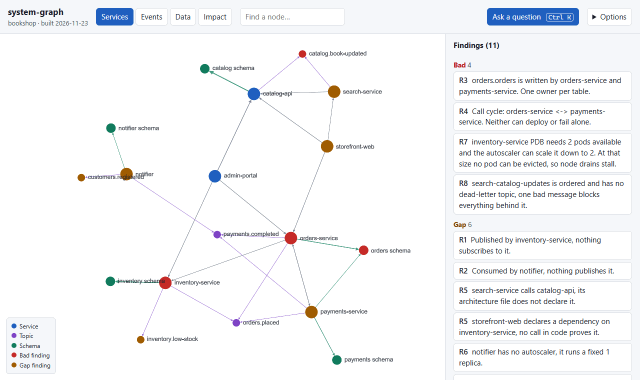

# system-graph

[](https://github.com/glympero/system-graph/actions/workflows/ci.yml)
[](LICENSE)

**Architecture diagrams drift because people draw them.** system-graph generates the map from code and
infrastructure, proves every connection with a file and line, runs architecture rules over it, and lets you explore it
in a browser or ask an AI assistant about it through MCP.

**[Live demo](https://glympero.github.io/system-graph/)** on a fictional nine-service bookshop.



## What it answers

- **What breaks if I change this?** Every service within N steps of a table, endpoint, topic or service, with the line
  of code behind each step.
- **Who calls this endpoint? Who reads this table? Who listens to this topic?**
- **How does A reach B?** The shortest chain of HTTP calls and events between two services.
- **What is wrong with the architecture?** Eight rules find shared tables, call cycles, events nobody consumes, services
  that cannot scale, disruption budgets that block every node drain, and drift between what teams declare and what
  the code does.

Every answer, in the browser and through MCP, cites `file:line` and links to the exact line on GitHub.

## Quick start (60 seconds)

Needs Python 3.12+ (no packages) and Node 22.18+.

```bash
git clone https://github.com/glympero/system-graph && cd system-graph
python -m sysgraph build examples/bookshop   # writes out/graph.json, out/findings.json, out/COVERAGE.md
npm ci && npm run view                       # opens the explorer at http://localhost:5173
```

```text
62 nodes, 85 edges, 11 findings (4 Bad, 6 Gap, 1 Good) -> out/
```

Press <kbd>Ctrl</kbd>+<kbd>K</kbd> and ask "What breaks if this changes?" about `orders.orders`, or click a finding
in the side panel and follow its evidence to the line that causes it.

## The demo estate

[`examples/bookshop`](examples/bookshop) is Inkwell, a made-up online bookshop. Its nine repos are small but written
like real services, and a few problems were planted on purpose. [`EXPECTED.md`](examples/bookshop/EXPECTED.md) lists
every planted problem, and a test asserts the build finds exactly those, no more and no less.

| Repo | Stack | Role |
|---|---|---|
| `storefront-web` | React, `fetch` | The shop. Browse, search, check out |
| `admin-portal` | Next.js, axios | Back office for the catalogue, stock and orders |
| `catalog-api` | Express, kafkajs, Postgres | Books and authors, publishes `catalog.book-updated` |
| `search-service` | Express, kafkajs, Elasticsearch | Full-text search fed by catalogue events |
| `orders-service` | Spring Boot, Kafka, JDBC | Takes orders, reserves stock, asks payments to charge |
| `payments-service` | Spring Boot, Kafka, JDBC | Charges cards, and writes the orders table it does not own |
| `inventory-service` | Spring Boot, Kafka, JDBC | Stock and reservations |
| `notifier` | Node, kafkajs | Emails, waits for an event nobody sends |
| `infra` | Terraform, Kubernetes | Pub/Sub topics and subscriptions, Deployments, HPAs, PDBs |

## How it works

```mermaid
flowchart LR
  cfg[sysgraph.yaml] --> fetch[fetch<br/>local folder or git clone]
  fetch --> ext[extractors<br/>one plugin per stack]
  ext --> merge[merge, resolve,<br/>validate]
  merge --> graph[(out/graph.json)]
  graph --> rules[8 rules] --> findings[(out/findings.json)]
  graph --> core[TypeScript core<br/>index, lenses, questions]
  findings --> core
  core --> ui[React explorer]
  core --> mcp[MCP server]
```

1. **Fetch.** Each repo in `sysgraph.yaml` is read in place or shallow-cloned.
2. **Extract.** Each extractor is one module with `extract(repo) -> nodes and edges`, a fixed confidence and a list of
   blind spots. Adding a stack means adding a module to a list.
3. **Merge.** Nodes are deduplicated, HTTP calls are matched to the route they hit (`/books/${id}` matches
   `GET /books/:id`), bare table names resolve to their migration, and any edge without provenance fails the build.
4. **Rules** run in plain Python over an in-memory index.
5. **Publish** is atomic: write to `out.next/`, validate, swap file by file, keep `out.prev/`. The same input gives
   byte-identical output, which a test proves.

Every edge carries its evidence:

```json
{"from": "service:payments-service", "to": "table:orders.orders", "rel": "writes_table", "source": "code",
 "file": "payments-service/src/main/java/com/inkwell/payments/OrderStatusWriter.java", "line": 18,
 "confidence": 0.8, "extractor": "table_usage"}
```

### Extractors

| Extractor | Reads | Produces |
|---|---|---|
| `express_routes` | `app.get(...)`, `router.post(...)` | endpoints |
| `spring_routes` | `@GetMapping` etc. under a class-level `@RequestMapping` | endpoints |
| `http_clients` | `fetch` and axios with an env var base URL, Spring `RestClient` | calls, matched to endpoints |
| `kafka_code` | `KafkaTemplate.send`, `@KafkaListener`, kafkajs `send` and `subscribe` | publishes, subscribes |
| `sql_migrations` | Flyway `V1__*.sql` `CREATE TABLE` | tables, schemas |
| `table_usage` | SQL in application code | reads, writes |
| `k8s_scaling` | Deployment replicas, HPA min/max/metrics, PDB minAvailable | scaling facts on services |
| `terraform_pubsub` | `google_pubsub_topic`, `google_pubsub_subscription`, dead-letter policy | topics, subscriptions |
| `declared` | `architecture.yaml` in each repo | what the team says it depends on |

Each build writes `out/COVERAGE.md`: what every extractor found, how far to trust it, and what it cannot see.

### Rules

| Rule | Finds | Label |
|---|---|---|
| R1 | A topic with publishers and no subscribers | Gap |
| R2 | A subscriber to a topic nobody publishes | Gap |
| R3 | A table written by more than one service | Bad |
| R4 | A call cycle between services | Bad |
| R5 | A declared dependency with no proof in code, or a proven call nobody declared | Gap |
| R6 | A service with no autoscaler, or one pinned at min = max | Gap |
| R7 | A PDB whose minAvailable is at least the replica count, so no pod can ever be evicted | Bad |
| R8 | A subscription with a dead-letter topic (Good), or an ordered one without (Bad) | Good / Bad |

## Ask your AI assistant (MCP)

The MCP server exposes one tool per explorer question (`impact`, `connects`, `callers`, `publishers`, `subscribers`,
`table_users`, `path`, `pinned`, `drift`, `rule`) plus `find_nodes` and `findings`. It runs the same TypeScript code as
the explorer, so both always give the same answer.

```bash
# Claude Code
claude mcp add system-graph -- node /path/to/system-graph/web/mcp/server.ts
```

```json
{ "mcpServers": { "system-graph": { "command": "node", "args": ["/path/to/system-graph/web/mcp/server.ts"],
  "env": { "SYSGRAPH_VIEW_URL": "http://localhost:5173/" } } } }
```

`SYSGRAPH_OUT` points it at another output folder. `SYSGRAPH_VIEW_URL` sets where deep links open.

A short session, with the tool output exactly as the server returns it (trimmed):

> **You:** What breaks if I change the orders table?
>
> *Assistant calls `impact` with `{"node": "orders.orders", "depth": 2}`*
>
> ```text
> # What breaks if orders.orders changes
> 6 services within 2 steps.
>
> - orders-service (directly via orders.orders)
>   - orders-service/src/main/java/com/inkwell/orders/OrderRepository.java:19 orders-service writes orders.orders
> - payments-service (directly via orders.orders)
>   - payments-service/src/main/java/com/inkwell/payments/OrderStatusWriter.java:18 payments-service writes orders.orders
> - admin-portal (2 steps via orders-service)
>   - admin-portal/src/lib/api.ts:24 admin-portal calls orders-service GET /orders
> - inventory-service (2 steps via orders-service)
>   - inventory-service/src/main/java/com/inkwell/inventory/OrderPlacedListener.java:15 inventory-service subscribes to orders.placed
> - notifier (2 steps via payments-service)
>   - notifier/src/consumers.ts:13 notifier subscribes to payments.completed
> - storefront-web (2 steps via orders-service)
>   - storefront-web/src/api/orders.ts:6 storefront-web calls orders-service POST /orders
>
> Open in the explorer: https://glympero.github.io/system-graph/#lens=impact&focus=table%3Aorders.orders&depth=2&q=impact&a.node=table%3Aorders.orders&a.depth=2
> ```
>
> **Assistant:** Two services touch the table directly. orders-service owns it, but payments-service also writes it
> in `OrderStatusWriter.java:18`, which is rule R3. Four more services are one step further out: storefront-web and
> admin-portal call orders-service, and inventory-service and notifier consume events that the two writers publish.
> The link opens this exact view in the explorer.

## Use it on your own repos

```yaml
# sysgraph.yaml
name: my-platform
link: https://github.com/my-org/{repo}/blob/main/{path}#L{line}   # optional, makes evidence clickable
env_aliases:                                                     # optional, when env var names do not match services
  LEGACY_API_HOST: billing-service
repos:
  - name: billing-service
    git: https://github.com/my-org/billing-service.git
    ref: main
  - name: web
    path: ../web
  - name: platform-infra
    git: git@github.com:my-org/platform-infra.git
    service: false          # infra only, deploys no service of its own
```

```bash
python -m sysgraph build path/to/folder-with-sysgraph-yaml --out out
npm run view
```

## Design decisions

- **Python standard library only for the pipeline.** It installs anywhere, and a small YAML subset reader replaces
  PyYAML.
- **No graph database in v1** ([ADR 1](docs/adr/0001-no-graph-database-in-v1.md)). Rules are plain functions over an
  in-memory index. The ADR says when a graph database would earn its place.
- **Provenance on every edge** ([ADR 2](docs/adr/0002-provenance-on-every-edge.md)). No evidence, no edge.
- **One shared core for the UI and MCP** ([ADR 3](docs/adr/0003-one-shared-core-for-ui-and-mcp.md)). A question is
  written once and shows up in the palette and as an MCP tool.
- **Static analysis, not an LLM, does the extraction.** It is deterministic, cheap to rerun in CI and easy to test.
  The AI part sits on top, where it explains evidence instead of producing it.
- **Everything is in the URL.** Lens, selection, question and finding live in the hash, so any view is a link.
- **Accessible.** The palette is a native `<dialog>` with a keyboard-driven combobox. Every panel works by keyboard
  with visible focus. Colours meet WCAG 2.1 AA contrast in light and dark themes, and everything the canvas shows is
  also reachable as text in the panels.

## Quality

| Check | What it covers |
|---|---|
| `python -m unittest discover -s tests -t .` | One test per extractor (fixture files in, nodes and edges out), the rules golden test against `EXPECTED.md`, determinism, atomic publish |
| `npm test` | A Vitest golden test per question, lens and link tests, and an MCP smoke test over stdio |
| `npm run test:e2e` | Playwright: ask a question, follow a finding to its GitHub link, restore a shared link |
| `npm run lint`, `npm run typecheck` | ESLint (typescript-eslint strict, react-hooks) and `tsc` in strict mode |

CI runs all of it on every push and publishes the explorer over the demo estate to GitHub Pages.

## What I would do next

- Incremental builds that rescan only the repos that changed.
- More stacks per concern (Go and Python routes, gRPC, SQS/SNS, Helm rendering), now that the plugin interface is set.
- Architecture history: keep each `graph.json` and show what changed between two builds, in a PR comment.
- A graph database once estates outgrow memory or people want ad-hoc queries (see ADR 1).
- Ideas left out of v1 on purpose: hosted SaaS, auth, LLM-based extraction.

## Project layout

```text
sysgraph/            Python pipeline: config, fetch, extractors/, merge, rules, build
tests/               unittest: extractors, YAML reader, pipeline golden and determinism tests
examples/bookshop/   the fictional demo estate and EXPECTED.md
web/src/core/        framework-free TypeScript: graph index, lenses, questions, links
web/src/             React explorer (sigma.js, graphology, ForceAtlas2)
web/mcp/             MCP server
e2e/                 Playwright smoke tests
docs/adr/            architecture decision records
```

## Licence

[MIT](LICENSE)
